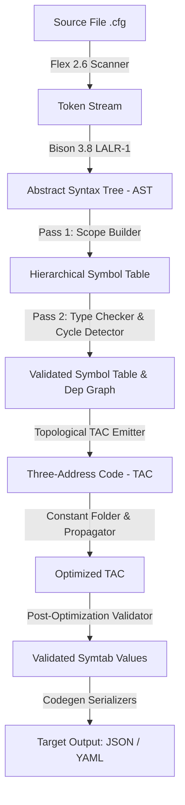

# ConfigLang: A Typed Configuration Language Compiler with Semantic Validation

[](https://en.wikipedia.org/wiki/C11_(C_standard_revision))
[](https://www.gnu.org/software/bison/)
[](https://www.gnu.org/software/make/)
[](https://valgrind.org/)

**ConfigLang** is an end-to-end, industrial-grade compiler built in C11 from scratch (zero external dependencies) that compiles human-friendly, strongly-typed configuration files (`.cfg`) into standard **JSON** and **YAML**.

Developed as the Innovative Project for **Principles of Compiler Design (PCD - 4CS501CC25)** at **Nirma University**.

---

## 👥 Authors
- **Urva Gandhi** (Roll No: `23BCE078`)
- **Rakshit Gajnotar** (Roll No: `23BCE077`)

---

## ✨ Features & Highlights

- **Pure Reentrant Scanning (`Flex 2.6`)**: Tracks exact line and column ranges with `YY_USER_ACTION`, supports escape sequence decoding, block/line comments, and longest-match disambiguation (e.g. range slices `1..65535` vs numeric dot).
- **Conflict-Free LALR(1) Parser (`Bison 3.8`)**: Formally proven grammar with zero shift/reduce and zero reduce/reduce conflicts (`%expect 0`). Features panic-mode syntax error recovery (`error SEMI`).
- **Arena Memory Management**: High-performance chunked 8-byte aligned arena allocator (`arena_t`) holding all AST nodes, symbols, and TAC instructions. Guarantees $O(1)$ allocations and zero memory leaks under Valgrind.
- **Hierarchical Symbol Table & Two-Pass Semantic Analysis**:
  - **Pass 1**: Scoped block tree with chained hash map for $O(1)$ canonical dot-path lookup (`server.port`). Rejects duplicate keys (`E301`).
  - **Pass 2**: Strong type validation (`int`, `float`, `string`, `bool`), range constraint validation (`E304`), reference resolution (`E305`, `E309`), and cycle detection via DFS coloring (`E306`).
- **Three-Address Code (TAC) & Dataflow Optimization**:
  - Emits linear intermediate representation in strict topological dependency order (`--tac`).
  - Constant propagation, constant folding with 64-bit checked arithmetic (`E308` division by zero, `E310` integer overflow), and dead temporary elimination (`--tac-opt`).
- **Post-Optimization Constraint Validator**: Enforces numeric ranges (`E303`) and verifies IEEE-754 floating point finiteness.
- **Dual Serialization Backends**: Generates formatted, 2-space indented standard JSON and YAML.
- **Clang/Rust-Style Diagnostics**: Multi-line contextual snippets with column gutters, source text, and exact carets (`^^^^`) matching all error (`E101`–`E310`) and warning (`W401`, `W402`) specifications.

---

## 🚀 Quick Start

### Prerequisites
- GCC (`gcc >= 11.0` supporting C11)
- GNU Flex (`flex >= 2.6.4`)
- GNU Bison (`bison >= 3.8.2`)
- GNU Make (`make >= 4.3`)
- Valgrind (optional, for memory auditing)

```bash
# Ubuntu/Debian installation
sudo apt-get update
sudo apt-get install -y build-essential flex bison valgrind
```

### Building the Compiler
```bash
# Clean and build the release binary
make clean && make
```
The binary will be produced at `build/configlang`.

### Running Tests & Verification
```bash
# Run the complete automated test suite (79 assertions across 5 phases)
make test

# Run full Valgrind memory leak and safety verification
make memcheck

# Run the 8-phase demonstration pipeline on examples/server.cfg
make demo
```

---

## 💻 CLI Usage

```
Usage: ./build/configlang [options] <input-file>

Options:
  -o, --output <file>       Write result to file (default: stdout)
  -f, --format <json|yaml>  Output format: json (default) or yaml
      --tokens              Dump token stream from lexical analysis
      --ast                 Dump indented abstract syntax tree
      --symtab              Dump symbol table with scope and types
      --deps                Dump dependency graph edges
      --tac                 Dump unoptimized Three-Address Code
      --tac-opt             Dump optimized TAC and optimization stats
      --phases              Enable all intermediate dumps with banner headers
      --no-color            Disable ANSI color codes in diagnostics
  -h, --help                Display command line usage and exit
  -v, --version             Print compiler version (configlang 1.0.0)
```

### Examples

Compile to JSON:
```bash
./build/configlang examples/server.cfg
```

Compile to YAML and save to a file:
```bash
./build/configlang -f yaml -o build/server.yaml examples/server.cfg
```

Inspect compiler optimization and intermediate code:
```bash
./build/configlang --tac-opt examples/server.cfg
```

Inspect token stream:
```bash
./build/configlang --tokens examples/server.cfg
```

---

## 📋 The 8-Phase Compiler Pipeline



1. **Phase 1 (Lexical Analysis)**: Pure reentrant Flex scanner transforms `.cfg` source characters into typed tokens with exact `(line, col, len)` spans.
2. **Phase 2 (Syntax Analysis)**: Bison LALR(1) parser builds a clean tagged-union AST residing in chunked arena memory.
3. **Phase 3 (Symbol Table Pass 1)**: Traverses AST to build hierarchical scope tree; registers all identifiers and blocks; rejects duplicate keys.
4. **Phase 4 (Semantic Analysis Pass 2)**: Resolves references (`@path`), infers undeclared types, validates operators, and checks for dependency cycles using DFS 3-color marking.
5. **Phase 5 (Intermediate Code Generation)**: Generates 3-Address Code (TAC) in topological order according to cross-variable dependencies.
6. **Phase 6 (Optimization)**: Iteratively propagates known constants, folds compile-time arithmetic operations, and eliminates dead temporary registers.
7. **Phase 7 (Validation)**: Validates evaluated values against declared numeric range constraints (`lo..hi`) and checks float finiteness.
8. **Phase 8 (Code Generation)**: Serializes evaluated symbol hierarchy into standard JSON or YAML.

---

## 🚨 Diagnostic Reference Codes

| Code | Severity | Description |
|:---:|:---:|:---|
| **E101** | Error | Illegal / unrecognized source character |
| **E102** | Error | Unterminated string literal |
| **E103** | Error | Integer literal exceeds 64-bit bounds (`INT64_MIN`..`INT64_MAX`) |
| **E104** | Error | Invalid escape sequence in string literal |
| **E105** | Error | Unterminated multi-line block comment |
| **E201** | Error | Syntax error (unexpected token, missing delimiter, malformed expression) |
| **E301** | Error | Duplicate identifier declaration in same scope |
| **E302** | Error | Type mismatch between declared type and expression value |
| **E303** | Error | Evaluated runtime value violates declared range constraint `[lo..hi]` |
| **E304** | Error | Invalid range constraint declaration (lower bound > upper bound, or non-numeric) |
| **E305** | Error | Undefined variable reference (`@name`) |
| **E306** | Error | Circular dependency cycle detected among variable references |
| **E307** | Error | Invalid operand type for operator (e.g. string multiplication) |
| **E308** | Error | Division by zero in constant expression |
| **E309** | Error | Reference points to a scope block rather than a scalar value |
| **E310** | Error | Integer arithmetic overflow during constant folding |
| **E901** | Error | I/O error (input file not found or cannot be read) |
| **W401** | Warning | Empty block declaration |
| **W402** | Warning | Implicit numeric widening from `int` to `float` |

---

## 📚 Syllabus Mapping (Principles of Compiler Design)

| Course Module / Topic | Implementation in ConfigLang | Primary Source Files |
|:---|:---|:---|
| **Lexical Analysis (Scanner)** | Flex pure reentrant scanner, regular expressions, longest match, token buffering, string unescaping | [`src/lexer.l`](file:///home/urva/Documents/Academics/Semester%20-%207/PCD/Innovative/src/lexer.l), [`src/lexer.h`](file:///home/urva/Documents/Academics/Semester%20-%207/PCD/Innovative/src/lexer.h) |
| **Syntax Analysis (Parser)** | Bison LALR(1) parser, `%expect 0`, operator precedence declarations (`%left`, `%right`), panic-mode error recovery | [`src/parser.y`](file:///home/urva/Documents/Academics/Semester%20-%207/PCD/Innovative/src/parser.y) |
| **Syntax-Directed Translation (SDT)** | Semantic actions constructing tagged-union AST nodes in arena memory | [`src/ast.c`](file:///home/urva/Documents/Academics/Semester%20-%207/PCD/Innovative/src/ast.c), [`src/ast.h`](file:///home/urva/Documents/Academics/Semester%20-%207/PCD/Innovative/src/ast.h) |
| **Symbol Tables & Scope Management** | Chained hash table ($O(1)$ lookup) + hierarchical scope tree preserving source declaration order | [`src/symtab.c`](file:///home/urva/Documents/Academics/Semester%20-%207/PCD/Innovative/src/symtab.c), [`src/symtab.h`](file:///home/urva/Documents/Academics/Semester%20-%207/PCD/Innovative/src/symtab.h) |
| **Semantic Analysis & Type Systems** | Two-pass type checking, type inference, implicit widening, range constraint checks, DFS cycle detection | [`src/semantic.c`](file:///home/urva/Documents/Academics/Semester%20-%207/PCD/Innovative/src/semantic.c), [`src/semantic.h`](file:///home/urva/Documents/Academics/Semester%20-%207/PCD/Innovative/src/semantic.h) |
| **Intermediate Code Generation** | Three-Address Code (TAC) representation with quadruples, topological dependency ordering | [`src/tac.c`](file:///home/urva/Documents/Academics/Semester%20-%207/PCD/Innovative/src/tac.c), [`src/tac.h`](file:///home/urva/Documents/Academics/Semester%20-%207/PCD/Innovative/src/tac.h) |
| **Code Optimization** | Constant propagation, checked compile-time constant folding, dead code / dead temporary register elimination | [`src/optimizer.c`](file:///home/urva/Documents/Academics/Semester%20-%207/PCD/Innovative/src/optimizer.c), [`src/optimizer.h`](file:///home/urva/Documents/Academics/Semester%20-%207/PCD/Innovative/src/optimizer.h) |
| **Code Generation & Serialization** | Target language emission (JSON / YAML serializers) with proper string escaping and indentation | [`src/codegen.c`](file:///home/urva/Documents/Academics/Semester%20-%207/PCD/Innovative/src/codegen.c), [`src/codegen.h`](file:///home/urva/Documents/Academics/Semester%20-%207/PCD/Innovative/src/codegen.h) |
| **Run-Time Environment & Storage** | Chunked arena memory allocator, safe string buffers, diagnostic error reporting engine | [`src/arena.c`](file:///home/urva/Documents/Academics/Semester%20-%207/PCD/Innovative/src/arena.c), [`src/diag.c`](file:///home/urva/Documents/Academics/Semester%20-%207/PCD/Innovative/src/diag.c), [`src/util.c`](file:///home/urva/Documents/Academics/Semester%20-%207/PCD/Innovative/src/util.c) |

---

## 📁 Repository Structure

```
├── Makefile                 # Portable GNU Makefile (all, test, memcheck, demo, clean)
├── README.md                # Project documentation and syllabus guide
├── docs/                    # Formal engineering documentation
│   ├── SRS.md               # Software Requirements Specification
│   ├── DESIGN.md            # Architecture and implementation design document
│   ├── GRAMMAR.md           # Formal lexical and context-free grammar specification
│   ├── TEST_PLAN.md         # Verification matrix and test traceability
│   ├── VIVA_NOTES.md        # Comprehensive 25+ viva preparation Q&A guide
│   └── DECISIONS.md         # Architecture Decision Records (ADRs)
├── src/                     # C11 Compiler Source Code
│   ├── main.c               # Compiler CLI driver & 8-phase pipeline orchestrator
│   ├── arena.h, arena.c     # 8-byte aligned chunked arena allocator
│   ├── util.h, util.c       # Safe allocation wrappers, dynamic string buffers, file loader
│   ├── diag.h, diag.c       # Diagnostic reporting engine with ANSI carets & gutters
│   ├── lexer.l, lexer.h     # Reentrant Flex lexical scanner
│   ├── parser.y, parser.h   # Bison LALR(1) grammar specification
│   ├── ast.h, ast.c         # Tagged-union AST node hierarchy & tree dumper
│   ├── symtab.h, symtab.c   # Scope tree & chained hash symbol table
│   ├── semantic.h, semantic.c# Two-pass semantic analyzer, type checker, cycle detector
│   ├── tac.h, tac.c         # Three-Address Code generator & IR dumper
│   ├── optimizer.h, optimizer.c # Constant propagation, constant folding, dead code elimination
│   ├── validator.h, validator.c # Post-optimization range & finiteness validator
│   └── codegen.h, codegen.c # JSON & YAML code generators
├── examples/                # Example configurations
│   ├── server.cfg           # Comprehensive valid server configuration
│   └── server.json          # Golden JSON output
└── tests/                   # Automated Test Suite
    ├── run_tests.sh         # Test runner executing 79 assertions
    ├── valid/               # Valid configuration test cases (14 cases)
    └── invalid/             # Negative error test cases with .expected files (35 cases)
```

---

## 📜 License
Educational project developed for PCD (Principles of Compiler Design, 4CS501CC25) at Institute of Technology, Nirma University. All rights reserved by authors Urva Gandhi and Rakshit Gajnotar.
